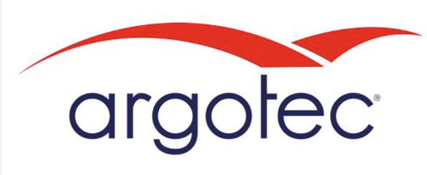
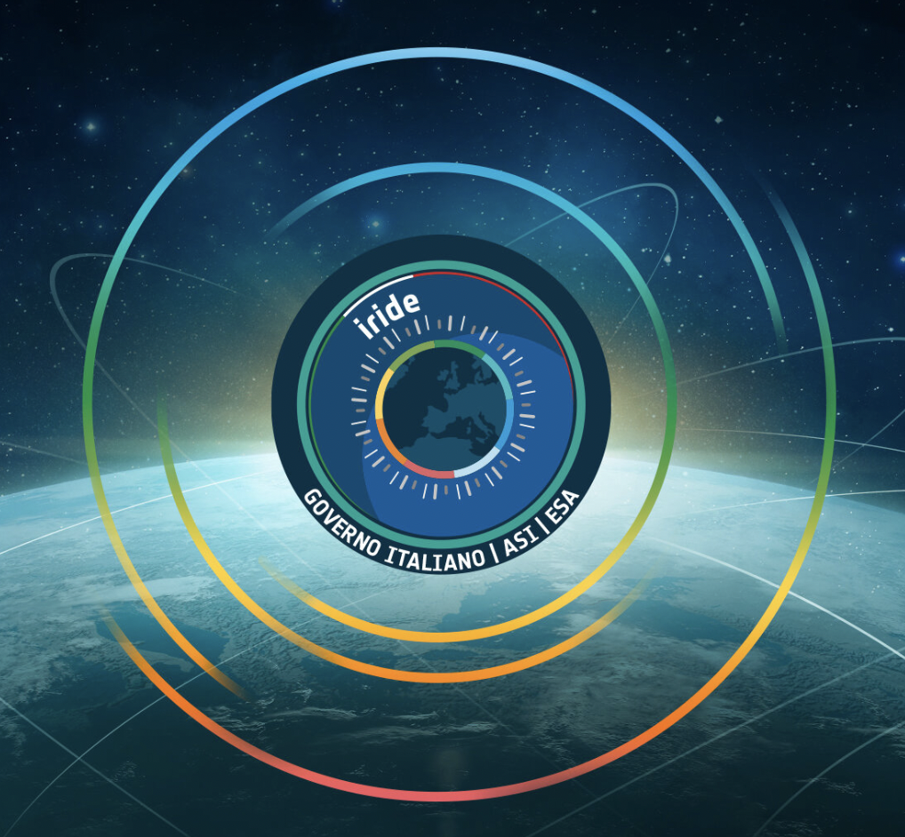
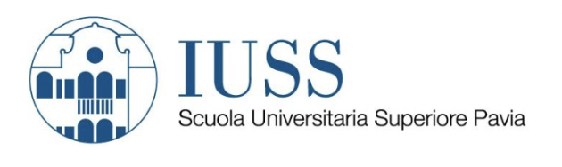
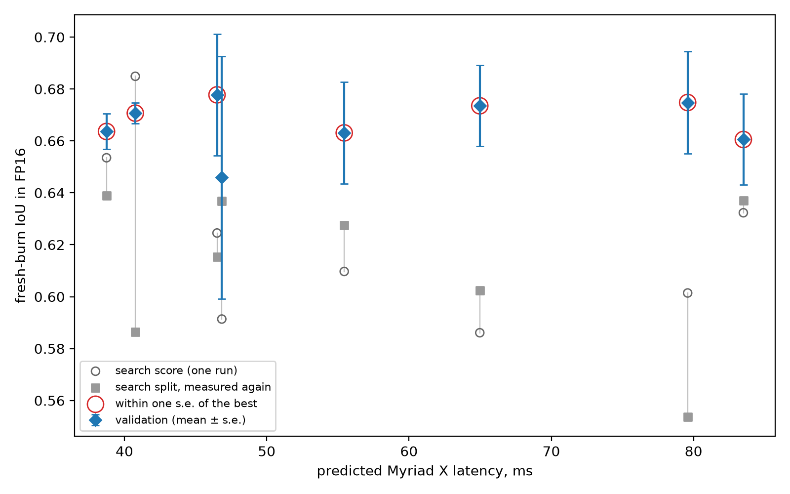
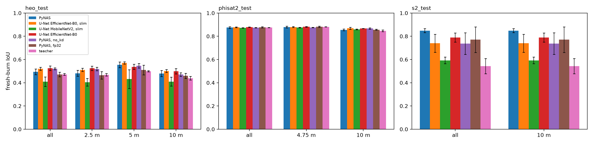
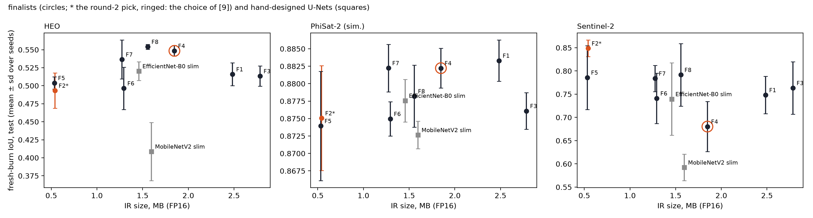
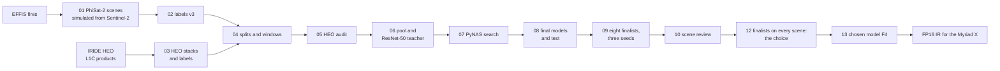

<p align="center">
  
  &nbsp;&nbsp;
  
  &nbsp;&nbsp;
  
  &nbsp;&nbsp;
  
  &nbsp;&nbsp;
  
</p>

<h1 align="center">On-board burn-scar mapping for IRIDE HEO</h1>

<p align="center"><b>Hardware-aware neural architecture search for burnt-area segmentation on the Intel Movidius Myriad X</b></p>

<p align="center">
  
  
  
  
  <a href="https://arxiv.org/abs/2604.24492"></a>
  
  
  
</p>

> **Why on board.** This work is being prepared to reduce the latency of burnt-area information for the Italian Civil
> Protection Department (Dipartimento della Protezione Civile, DPC). The map is made on the satellite right after the
> acquisition, so only the burn-scar maps and a short summary need to be downlinked instead of the full multispectral
> image.

## Contents

- [Overview](#overview)
- [Results](#results)
- [Pipeline](#pipeline)
- [Repository layout](#repository-layout)
- [Getting started](#getting-started)
- [Data](#data)
- [On-board application](#on-board-application)
- [Team](#team)
- [Acknowledgements](#acknowledgements)
- [Related publications](#related-publications)
- [Citation](#citation)
- [License](#license)

## Overview

The network classifies every pixel of an IRIDE HEO L1C image (seven bands: blue, green, red, red edge 1-3 and NIR, at
2.5 m) as clear land, **fresh burn scar**, old burn scar, cloud, cloud shadow or water. It runs on the Intel Movidius
Myriad X of the satellite's payload data processor as an FP16 OpenVINO 2022.3.1 model, on chips of 4096 x 4096 pixels
cut into tiles of 256 x 256.

- **Data.** 35 HEO scenes, 383 PhiSat-2 scenes simulated from Sentinel-2 over EFFIS fires, and three Sentinel-2 test
  chips. Burns come from EFFIS burnt-area polygons, aged into fresh (0 to 90 days) and old (90 to 365 days) burns;
  clouds and shadows from OmniCloudMask; water from NDWI. A 10 m band along every burn edge is left out of training and
  of the scores.
- **Search.** [PyNAS](pyqnas/) runs an NSGA-II search over the encoder, the searched layers and the decoder. Every
  candidate is exported as an FP16 IR and compiled for the Myriad X *before* it is trained; candidates are trained in
  FP16 with distillation from a ResNet-50 U-Net teacher and ranked on accuracy and predicted latency (nn-Meter).
- **Selection.** The eight best candidates were trained again with three seeds each, and the network was chosen on
  the validation scenes before the test scenes were opened.
- **Test.** Held-out HEO scenes at 2.5, 5 and 10 m, PhiSat-2 windows and Sentinel-2 chips, scored in FP16 as the
  network runs on board.

## Results

The chosen network, F4:

| | |
|---|---|
| Architecture | `E:eb0:4/L:conv:128:5:1:relu:max/D:dws:64:1`: an EfficientNet-B0 encoder cut after four stages (ImageNet weights, first layer fitted to seven bands); max pooling and a 5 x 5 convolution of 128 channels with ReLU; a U-Net decoder with one depthwise-separable convolution of 64 channels per stage |
| Parameters | 0.83 M |
| FP16 OpenVINO IR | 1.92 MB, compiled for MYRIAD |
| Predicted latency on the Myriad X | 46.5 ms per 256 x 256 tile (nn-Meter); 256 tiles per 4096 x 4096 chip |
| Fresh-burn IoU on the held-out test sets (FP16, mean ± s.d. over three trainings) | HEO 0.55 ± 0.01 · PhiSat-2 0.88 ± 0.00 · Sentinel-2 0.68 ± 0.05 |
| CPU run in a container of 2 cores and 512 MB | 2 to 10 s per 4096 x 4096 chip, peak memory about 300 MB |

HEO: two test scenes at 2.5, 5 and 10 m. PhiSat-2: windows sampled around burns. Sentinel-2: the test chips at 10 m.
The full tables are in [final_table.csv](final_table.csv), [test_table.csv](test_table.csv) and
[test_per_gsd.csv](test_per_gsd.csv).

<p align="center"><br><em>The finalists of the search (round 2).</em></p>

<p align="center"><br><em>Fresh-burn IoU on the test sets by pixel size (round 2).</em></p>

<p align="center"><br><em>Test IoU against model size.</em></p>

## Pipeline



| notebook | what it does |
|---|---|
| [01_phisat2_simulation](notebooks/01_phisat2_simulation.ipynb) | PhiSat-2 scenes simulated from Sentinel-2 over EFFIS fires ([details](docs/phisat2_simulation.md)) |
| [02_labels_v3_from_v2](notebooks/02_labels_v3_from_v2.ipynb) | labels v3 (fresh and old burns, ignore band) of the PhiSat-2, Sentinel-2 and first HEO scenes |
| [03_labels_v3_from_heo_products](notebooks/03_labels_v3_from_heo_products.ipynb) | 7-band stacks and labels of the HEO L1C products |
| [04_dataset_splits](notebooks/04_dataset_splits.ipynb) | splits by scene and the windows of every split |
| [05_heo_audit](notebooks/05_heo_audit.ipynb) | checks of the HEO scenes |
| [06_pool_and_teacher](notebooks/06_pool_and_teacher.ipynb) | the window pool and the ResNet-50 U-Net teacher with its soft labels |
| [07_search](notebooks/07_search.ipynb) | the PyNAS search |
| [08_final_and_test](notebooks/08_final_and_test.ipynb) | final models of the first round and their test |
| [09_round2_finalists](notebooks/09_round2_finalists.ipynb) | the eight finalists, three seeds each |
| [10_scene_review](notebooks/10_scene_review.ipynb) | whole scenes of every split |
| [12_finalists_on_every_scene](notebooks/12_finalists_on_every_scene.ipynb) | the finalists on every scene; the choice, made before the test |
| [13_chosen_model](notebooks/13_chosen_model.ipynb) | the chosen model |

Notebook 11 packages the chosen model for Argotec's on-board environment with Argotec's SDK, which is not public, so it
is not part of this repository. The notebooks are stored without outputs; the executed notebooks are in the private
dataset.

## Repository layout

```
burnscar/            labels, scenes, splits, windows and training code of the experiment
pyqnas/              PyNAS: hardware-aware NAS for the Myriad X (Apache-2.0)
configs/burnscar.ini the experiment
notebooks/           the pipeline, in order
onboard/             the on-board application and its settings
scripts/             download_data.py
docs/                REPRODUCE.md, phisat2_simulation.md, figures/, logos/
data/README.md       what data/ holds once downloaded
effis_loader.py      EFFIS burnt-area polygons
*.csv                result tables
```

## Getting started

```bash
git clone https://github.com/paramkaur10/iride_onboard-burnscar-mapper.git
cd iride_onboard-burnscar-mapper
python3.12 -m venv .venv && source .venv/bin/activate
pip install -r requirements.txt     # first the PyTorch build for your CUDA, see https://pytorch.org
pip install -e pyqnas
hf auth login                       # an account with access to the data
python scripts/download_data.py     # data/ and models/, about 68 GB
jupyter lab                         # notebooks/, in order
```

Step by step, with what each notebook needs: [docs/REPRODUCE.md](docs/REPRODUCE.md).

## Data

| set | scenes | pixel | bands | used for |
|---|---|---|---|---|
| IRIDE HEO | 35 stacks, and 10 L1C products as delivered | 2.5 m | blue, green, red, red edge 1-3, NIR | train, search, validation, test |
| PhiSat-2 simulated from Sentinel-2 | 383 | 4.75 m | blue, green, red, red edge 1-3, NIR | train, validation, test |
| Sentinel-2 L1C | 3 chips | 10 m | 13 (7 used) | test |
| EFFIS burnt areas | 26,824 polygons | | | labels |

The data and the trained models are in a private Hugging Face dataset, `neet1797/iride-heo-burnscar`. The HEO images belong to the
IRIDE programme and cannot be redistributed; access for the reviewers is given through the editor. Every folder is
described in [data/README.md](data/README.md).

## On-board application

[`onboard/burnscar_app.py`](onboard/) runs the exported network the way the satellite does: it finds every image in a
folder, reads the seven bands one row of 256 x 256 tiles at a time, converts the stored values to reflectance as in
training, runs the FP16 IR on the Myriad X or on the CPU, and writes a class map for every image with burn scars and a
JSON summary. It needs only NumPy, the OpenVINO 2022.3.1 runtime and a GeoTIFF library.

## Team

| role | name | affiliation | contact |
|---|---|---|---|
| Developer, author and conception | **Parampuneet Kaur Thind** | IUSS Pavia · Sapienza University of Rome · ESA ESRIN | [parampuneet.thind@uniroma1.it](mailto:parampuneet.thind@uniroma1.it) · [Google Scholar](https://scholar.google.com/citations?user=Q71ynAkAAAAJ) · [GitHub](https://github.com/paramkaur10) · [LinkedIn](https://www.linkedin.com/in/param-thind/) |
| Supervisor | Andrea Taramelli | ISPRA · IUSS Pavia | [Andrea.Taramelli@iusspavia.it](mailto:Andrea.Taramelli@iusspavia.it) |
| Co-supervisor | Gabriele Meoni | ESA ESRIN | [Gabriele.Meoni@esa.int](mailto:Gabriele.Meoni@esa.int) |
| Project supervisor | Enrico Cadau | ESA ESRIN | [Enrico.Cadau@esa.int](mailto:Enrico.Cadau@esa.int) |

## Acknowledgements

Developed with the IRIDE team at ESA ESRIN, Argotec, IUSS Pavia and Sapienza University of Rome, with the needs of the
Italian Civil Protection Department (DPC) in view. The PhiSat-2 scenes were simulated with the simulator of the
[OrbitalAI challenge](https://github.com/AI4EO/orbitalAI); clouds and shadows come from
[OmniCloudMask](https://github.com/DPIRD-DMA/OmniCloudMask); burnt areas from the European Forest Fire Information
System (EFFIS, © European Union); Sentinel-2 images from the Copernicus programme (contains modified Copernicus
Sentinel data 2020-2026).

## Related publications

1. P. K. Thind, V. Katturu, G. Zema, R. Del Prete, "Deployment-Aligned Low-Precision Neural Architecture Search for Spaceborne Edge AI", [arXiv:2604.24492](https://arxiv.org/abs/2604.24492), 2026. The method behind PyNAS.
2. P. K. Thind, C. Mwangi, G. Varetto, L. Sarti, A. Papa, A. Taramelli, "Assessing the Added Value of Onboard Earth Observation Processing with the IRIDE HEO Service Segment", [arXiv:2604.07120](https://arxiv.org/abs/2604.07120), 2026.
3. P. K. Thind, R. Del Prete, M. Whitley, A. Mazzeo, N. Longépé, G. Meoni, "NASEO: Neural architecture search for Earth observation onboard processing", 2025 European Data Handling & Data Processing Conference (EDHPC), pp. 1-8, 2025.
4. R. Del Prete, P. K. Thind, A. Mazzeo, M. Whitley, L. Papa, N. Longépé et al., "Optimizing deep learning models for on-orbit deployment through neural architecture search", Scientific Reports 15, 37783, 2025.

## Citation

```bibtex
@misc{thind2026pynas,
  author        = {Thind, Parampuneet Kaur and Katturu, Vaibhav and Zema, Giacomo and Del Prete, Roberto},
  title         = {Deployment-Aligned Low-Precision Neural Architecture Search for Spaceborne Edge AI},
  year          = {2026},
  eprint        = {2604.24492},
  archivePrefix = {arXiv}
}

@misc{thind2026repo,
  author       = {Thind, Parampuneet Kaur},
  title        = {On-board burn-scar mapping for {IRIDE} {HEO}},
  year         = {2026},
  howpublished = {\url{https://github.com/paramkaur10/iride_onboard-burnscar-mapper}}
}
```

## License

The code is under the [MIT License](LICENSE); PyNAS (`pyqnas/`) under the [Apache License 2.0](pyqnas/LICENSE). The data
are not covered by these licences: the HEO images belong to the IRIDE programme, Sentinel-2 data follow the Copernicus
data policy, and EFFIS data are © European Union.
